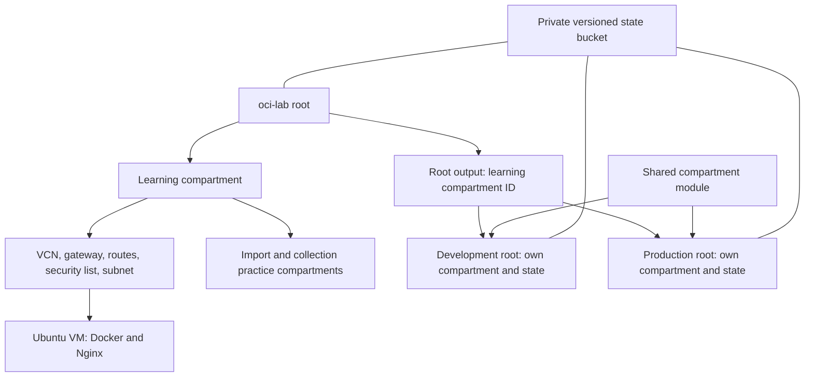

# Learning Terraform on OCI

A hands-on Infrastructure as Code project using Terraform, Oracle Cloud Infrastructure, and GitHub Actions. It provisions an Ubuntu VM running containerized Nginx, separates development and production compartment state, and demonstrates reviewed deployment of a saved Terraform plan.

This is a learning lab with practical automation, not a production reference architecture. Development and production currently contain separate compartments, not separate application stacks.

## Start here

- [VM and bootstrap guide](docs/vm-and-bootstrap-guide.md): complete VM/network/cloud-init code, explanations, and operating commands.
- [Practice guide](docs/terraform-practice-guide.md): exercises, reasoning, outcomes, and troubleshooting.
- [Repository cheat sheet](docs/repository-cheat-sheet.md): reusable commands and HCL examples, including complete mock tests.
- [Terraform checks](https://github.com/sepantakamali/learning-terraform/actions/workflows/terraform.yml): configuration and test runs.
- [Development deployment](https://github.com/sepantakamali/learning-terraform/actions/workflows/terraform-dev.yml): manually triggered plan and approved apply.

## Architecture



The state bucket is provisioned separately. Each root uses a different object key; the backend configuration connects to an existing bucket and does not create it. Remote-state reads expose root outputs but require access to the underlying snapshot.

## Repository layout

```text
main.tf                            Initial local_file exercise only
oci-lab/                           Foundation infrastructure root
  modules/web_server/              VM module
  cloud-init.yaml                  Automatic Docker/Nginx bootstrap
  collections.tf                  for_each, validation, lifecycle exercises
  import-practice.tf               Existing compartment import
environment-lab/
  dev/                             Development root
  prod/                            Production root
  modules/compartment/              Shared compartment module and mock tests
.github/workflows/
  terraform.yml                    Formatting, validation, mock tests
  terraform-dev.yml                Approved saved-plan deployment
docs/                             Learning guide and operational reference
```

Run Terraform in the intended root. Running it at repository top level executes the original local-file exercise, not all the cloud roots.

## What this project demonstrates

- Resource dependencies, references, inputs, outputs, and reusable modules.
- OCI networking, restricted-source SSH, and cloud-init bootstrapping.
- Remote state migration, locking, separate environment states, and state-output dependencies.
- Drift detection, imports, address migration with `moved`, and removal without cloud deletion.
- Structured collection inputs, validation, conditional tags, and lifecycle behavior.
- Provider aliases, version constraints, lockfiles, and cross-platform checksums.
- Mock-provider tests and GitHub pull-request checks.
- A restricted CI identity, environment approvals, encrypted plan artifacts, and application of the saved plan.

## Run checks without cloud deployment

The workflow uses Terraform 1.16.3; use the same version for consistent results. Git and Terraform are required. Initialization requires registry access to download the locked providers. These commands do not initialize cloud backends or apply infrastructure:

```bash
terraform fmt -check -diff -recursive
terraform -chdir=oci-lab init -backend=false -input=false
terraform -chdir=environment-lab/dev init -backend=false -input=false
terraform -chdir=environment-lab/prod init -backend=false -input=false
terraform -chdir=oci-lab validate
terraform -chdir=environment-lab/dev validate
terraform -chdir=environment-lab/prod validate
terraform -chdir=environment-lab/modules/compartment init -backend=false -input=false
terraform -chdir=environment-lab/modules/compartment test
```

The tests declare `mock_provider "oci" {}`. Their apply runs use mocked operations and do not create real OCI resources. The actual suite contains five tests: two naming tests and three owner-input tests. Expanded test examples in the cheat sheet are reference examples.

## Running against OCI

This repository contains lab-specific backend coordinates, imported resource IDs, and credential profile names. A new user must configure their own tenancy, private state bucket, state keys, credentials, region/image/AD choices, and import targets before using it. Do not point a fresh deployment at someone else's state or import IDs.

For this lab, local human access uses the `LEARNING_TERRAFORM` profile in `~/.oci/config`. Development selects it through shell environment variables:

```bash
export OCI_CONFIG_FILE_PROFILE=LEARNING_TERRAFORM
export OCI_config_file_profile=LEARNING_TERRAFORM
```

From `oci-lab`, supply an untracked `terraform.tfvars` with these inputs (replace every placeholder):

```hcl
tenancy_ocid        = "YOUR_TENANCY_OCID"
ssh_source_cidr     = "YOUR_PUBLIC_IPV4/32"
ssh_public_key_path = "~/.ssh/YOUR_PUBLIC_KEY.pub"
ubuntu_image_id     = "YOUR_COMPATIBLE_UBUNTU_X86_IMAGE_OCID"
```

Initialize the chosen backend, review a plan, and apply only intended changes. Dev and prod read the foundation's compartment output, so foundation state must exist first. The remote state bucket and access policies are prerequisites. For this repository's GitHub deployment exercise, apply dev changes through the workflow rather than also applying them locally.

## Approved development workflow

1. Make changes on a branch, run checks, and submit a PR.
2. Wait for required checks, review the diff, and merge into `main`.
3. Run `gh workflow run terraform-dev.yml --ref main` once.
4. Approve the plan job's access to the `development` environment.
5. Review `Plan development changes` in the completed job log.
6. Approve the apply job to execute that saved plan.

GitHub environment `development` requires a reviewer and permits deployments from the configured protected branch. It contains secrets `OCI_PRIVATE_KEY` and `TF_PLAN_PASSWORD`, plus variables `OCI_USER_OCID`, `OCI_TENANCY_OCID`, `OCI_FINGERPRINT`, and `OCI_REGION`. OCI IAM policies are configured separately to scope the automation identity to its dev responsibilities and required state objects.

The workflow uses two fresh runners. It encrypts the plan before uploading an artifact, retains it for three days, decrypts it for apply, and cleans up local credentials/files. Encryption protects stored artifact contents; plaintext exists on runners during use. Artifact names include the run attempt, so rerun all jobs rather than only apply. Starting another dispatch creates a new run; it does not continue the previous one.

## Verification and scope

As of 23 October 2026, the learner reported five passing tests, a dev plan adding only `owner = "platform-team"` (0 add / 1 change / 0 destroy), and a prod plan with no changes. The final assessment is passed. Deployment of that owner tag has not yet been reported. An earlier description change completed the approved deployment workflow successfully.

The VM serves HTTP for the lab; there is no claim of production TLS, high availability, application monitoring, or disaster-recovery certification. Mock tests do not validate live OCI permissions or capacity. State recovery principles are documented, but bucket-version restoration was not performed as an exercise. The repository is a record of learning, including retained migration and import blocks.

## Keeping the repository safe and useful

Commit `.terraform.lock.hcl` files, source, tests, and documentation. Do not commit credentials, private keys, state snapshots, private variable values, or saved plans. Existing `.gitignore` rules cover common Terraform files, not every possible secret filename. Review the staged diff before publishing.

Use the cheat sheet's targeted procedures for imports and removal. Do not run a blanket destroy to finish a lesson: dev/prod depend on the foundation, and collection resources have destruction protection. Keep documentation status aligned with what has actually been verified.
